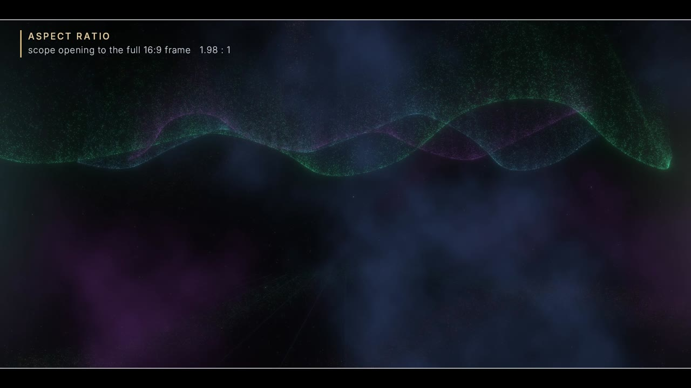
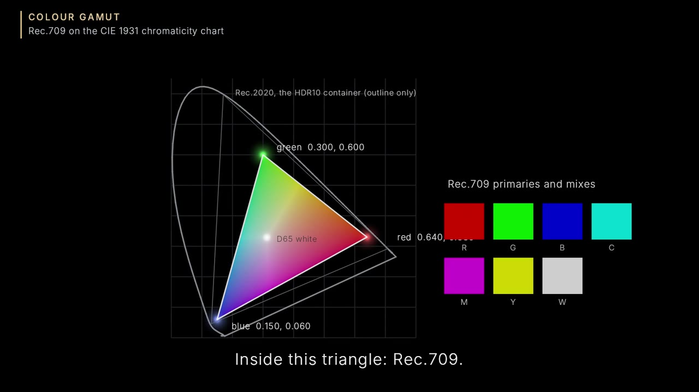
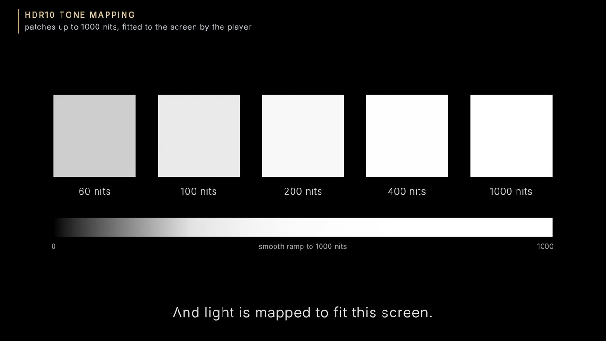

# The intro film: "A file becomes a room"

A 60 second original cinematic made for this rig. Picture and sound are generated by code from one score, so what is seen and what is heard share the same positions and times. Each section carries a small label saying what it is showing. Source: [`intro/`](https://github.com/praveenchandrahas/Software-Defined-Home-Theatre/tree/main/intro). The video files are not in the repository; they are built from the source.

**Status (2026-11-28): built, and checked by measuring the files and looking at still frames. It has not been watched in motion or listened to (including the voice-over), and has not been played on the rig.**







## What it shows

| Time | Label on screen | Picture | Sound |
|---|---|---|---|
| 0-7 s | Shadow detail | a point of light; near-black steps from 0.05 to 2 nits (2.39:1) | a few quiet notes |
| 7-16 s | Object panning | the point becomes eight, moving around the room | eight voices panned around the seat |
| 16-19 s | Aspect ratio | the frame grows from 2.39:1 to 16:9, with the ratio counting down | a swell into the heights, low rise in the sub |
| 19-28 s | Height channels | aurora and rain | rain and tones in the ceiling speakers |
| 28-35 s | Colour gamut | Rec.709 on the CIE 1931 chart, primaries, mixes; Rec.2020 as an outline | a bell for each primary, a chord for white |
| 35-40 s | HDR10 tone mapping | patches of 60, 100, 200, 400 and 1000 nits and a ramp | a higher, louder tone per patch |
| 40-43 s | Dynamic range | black, one line of text | the voice, then digital silence |
| 43-45 s | Object panning | something crosses overhead | a fly-over from front to back |
| 45-52 s | Dynamics and LFE | burst | the hit and low bass pulses |
| 52-60 s | | title | title chord and the spoken name |

The opening of the frame follows the idea familiar from IMAX presentations, where chosen sequences grow taller than the widescreen frame. No IMAX material, format or branding is used.

## Voice-over

The captions are spoken by a synthetic voice (Kokoro-82M, voice `af_heart`; model Apache-2.0, `kokoro-onnx` MIT), on the centre speaker, with everything else lowered by 6 dB under each line. It is generated at build time by `voice.py`; the model is downloaded separately and is not in the repository.

## How the sound is made

The positions are **pre-baked**: each sound is panned offline with [Spatial-Lab](spatial-lab.md)'s VBAP engine and the speaker directions of this room, and written to a 5.1.2 FLAC track. It is not Dolby Atmos, and nothing is rendered as an object at playback ([D19](decisions.md)). The layout is therefore fixed to this rig; another layout needs another render.

Channel order in the file: FL FR FC LFE BL (left height) BR (right height) SL SR. This is the 7.1 order of the file, which differs from the order of the interface's ports.

## How the picture is made

1080p24, rendered in linear light with NumPy and OpenCV and encoded as HDR10 (10-bit, BT.2020, PQ, peak 1000 nits), plus an SDR version. On the rig the player tone-maps the HDR file to the projector like any HDR film, so the brightness figures on screen are the values in the file, not light measured off the screen. The chart outline uses an analytic fit of the CIE 1931 colour matching functions (Wyman, Sloan and Shirley, 2013). Nothing here measures the projector's own gamut.

## Build and play

Needs ffmpeg with libx265 and libx264, Python 3 with NumPy, SciPy, OpenCV, Pillow, `kokoro-onnx` and `soundfile`, and the Inter font (the code expects the path of Ubuntu's `fonts-inter`).

```bash
cd intro
pip install kokoro-onnx soundfile    # in a virtual environment on Ubuntu
./get-voice-model.sh                 # once: about 355 MB, checked against voice-model.sha256
./build.sh                           # film (HDR10 and SDR) and the rig test file; ./build.sh bm_george for another voice

mpv-object-audio sdht-intro-rigtest.mkv    # test file first
mpv-object-audio sdht-intro.mkv
```

Start with the volume below the usual setting. If `mpv-object-audio` does not play the plain FLAC track (it always selects the object decoder; untried with FLAC), play it with `mpv`.

With the test file, check: each named speaker is the one that sounds; `eq` shows the film profile; click and flash coincide (if sound is late, try `--audio-delay=-0.03`); the brightness steps stay distinct; the sub does not rattle; CamillaDSP reports no clipped samples.

## Measured on the built files

These are measurements of the files, not of sound or light in the room.

- Each of the eight rig-test signals is only in its intended channel.
- Film: true peak -3.0 dBTP, integrated -22.7 LUFS, loudness range 13.2 LU. No limiter.
- Short-term maximum: opening -28, hit -15 LUFS (13 LU apart; the first plan aimed at about 20, and the voice-over raises the quiet opening).
- 42.2 to 42.95 s is digital zero.
- The test file's clicks are at 20.000 and 21.000 s; the hit's LFE starts at 45.000 s.
- Pixel values decoded from the HDR file match the stated steps: shadow squares 0.05, 0.1, 0.25, 0.5, 0.99, 2.01 nits; patches 60, 100, 199, 401, 1004 nits.
- A speech recogniser (Whisper base.en, run once on the centre channel) transcribed the nine spoken lines with the intended words, apart from spelling and "this screen" heard as "the screen". One line needed a comma in its spoken text to be heard correctly. This is not a substitute for listening.

Built with `kokoro-onnx` 0.6.1.

## Not verified

Motion on the projector, how it sounds, whether the voice-over is pronounced well, bass level and rattle, channel routing through PipeWire and CamillaDSP, which profile `eq` picks for the file, and playback with `mpv-object-audio`.

## Story

Every film arrives as a file. On disk it is quiet and flat: numbers in a row, one after another, going nowhere.

But folded inside it is a room.

Press play and a single point of light wakes up in the dark. Beneath it, six squares so faint you are not sure of the first one. It hums to itself, a note at a time, and you lean in, because you do not want to miss it.

Then it opens. One point becomes eight, and each one knows where it wants to be: beside the screen, past your shoulder, behind your head. You cannot see the ones behind you. You can only see their light on the walls, and hear exactly where they are.

Some places are above you. The black bars draw back, the picture grows taller than you thought it could, and the sound climbs with it and comes back down as rain.

Colour has its places too. Red, green and blue take their corners, and everything between them fills in. Then light: five squares, each brighter than the last, further than this screen can go, folded down to fit it.

Now the lights go out. You know this moment: the quiet scene, just before the loud one, with your thumb already on the volume button.

Leave the remote where it is.

Something comes out of the screen, crosses the ceiling, passes behind you. And the room, all of it, answers.

When the dust settles there are only words on the wall: software-defined home theatre. No box did this. A file, a laptop, some open software, seven speakers and a sub.

---

Dolby, Dolby Atmos, DTS and DTS:X are trademarks of their owners; this is not a Dolby or DTS product and is not endorsed by them. IMAX is a trademark of its owner; this project is not affiliated with or endorsed by it.
