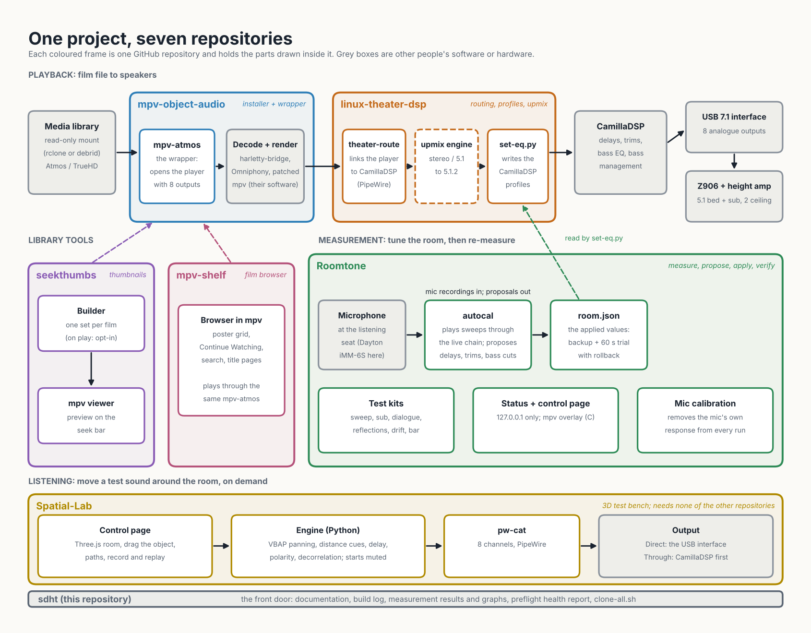

# The repositories

It is one project in six repositories (split from a single repository on 2026-10-25, history preserved in each; mpv-shelf was added on 2026-10-26).
This one, **sdht**, is the front door: the build log, documentation, results and graphs. Each repository now also has its own docs site (install
and usage reused from that repository's own README, not duplicated here).

| Repository | What it is | Docs site |
|---|---|---|
| **[sdht](https://github.com/praveenchandrahas/Software-Defined-Home-Theatre)** (this one) | documentation, build log, measurements' results and graphs, `preflight` health report, `clone-all.sh` / `test-all.sh` / `check-installed.sh`, the figure scripts | you're on it |
| **[linux-theater-dsp](https://github.com/praveenchandrahas/linux-theater-dsp)** | `eq` / `theater-route` (PipeWire routing), `set-eq.py` (CamillaDSP profiles: bass EQ, delays, trims, bass management), the stereo and 5.1-bed upmixers (`upmix.py`), the adaptive ambience engine (`upmix_engine.py`) with its offline test harness (`tools/upmixtest`), the systemd units, router tests | [docs](https://praveenchandrahas.github.io/linux-theater-dsp/) |
| **[mpv-object-audio](https://github.com/praveenchandrahas/mpv-object-audio)** | installer and wrapper for the live Atmos / DTS:X player (Omniphony, harletty-bridge, patched mpv) | [docs](https://praveenchandrahas.github.io/mpv-object-audio/) |
| **[seekthumbs](https://github.com/praveenchandrahas/seekthumbs)** | seek-bar thumbnails for a read-only film library (an rclone or debrid mount): built when you play a film, as a batch, or from a local web page where you tick the films and start, pause and stop; one set shared by the releases of a film; and the mpv viewer script | [docs](https://praveenchandrahas.github.io/seekthumbs/) |
| **[mpv-shelf](https://github.com/praveenchandrahas/mpv-shelf)** | a Netflix-style film browser inside mpv (poster grid, Continue Watching, search, title pages) over the same library folder; plays by file path | [docs](https://praveenchandrahas.github.io/mpv-shelf/) |
| **[Roomtone](https://github.com/praveenchandrahas/Roomtone)** | `autocal` (measure the room through CamillaDSP and propose a correction), test signals, recording procedures and analysers (sweep, sub, dialogue, reflections, soundbar comparison, second-sub drift), microphone calibration (`miccal.py`), REW data, the local control page (live per-speaker levels on a 5.1.2 plan, EQ and profile controls, an autocal page) and the mpv status overlay (key **C**) | [docs](https://praveenchandrahas.github.io/Roomtone/) |

*Every component in the repository that holds it. Grey boxes are other people's software or hardware.*

**Why not just EasyEffects or PipeWire's upmix?** They target standard layouts and sit outside the room correction; this rig is 5.1.2 with measured
per-speaker delays, trims and EQ, so the upmixer is written as CamillaDSP blocks in front of that chain. The comparison, and what the upmixers do
not do, is in the [linux-theater-dsp docs](https://praveenchandrahas.github.io/linux-theater-dsp/).

Clone them all side by side with `./scripts/clone-all.sh` (they find each other by folder name; `SDHT_WORKSPACE` overrides). Details:
[docs/repo-split.md](https://github.com/praveenchandrahas/Software-Defined-Home-Theatre/blob/main/docs/repo-split.md) in the repository.

**Words used across these sites.** *Remux*: a lossless copy of a disc's video and audio streams in a new file.
*Bed* and *heights*: the five ear-level speakers and the two ceiling speakers. *LFE*: the sub channel. *VBAP*: the panning method Omniphony uses to
place objects between speakers. *OSC*: the network control protocol Omniphony uses. *LR4*: a 24 dB per octave crossover filter. *`drone2`*,
*`thump20x`*, *`tight20x`*: named bass EQ presets (`drone2` is the one in use). *Standing profile*: the settings applied at every start. *STI*,
*C50*, *RT60*: speech-intelligibility, clarity and reverberation measures. *BS.1116*: the ITU-R listening-room recommendation whose early-reflection
limit (-10 dB) is used here. *Hot sub run*: the sub test repeated at higher level. *Dolby Amaze*: Dolby's Atmos demo clip. *Bar test*: a kit for
comparing the rig with a soundbar.
